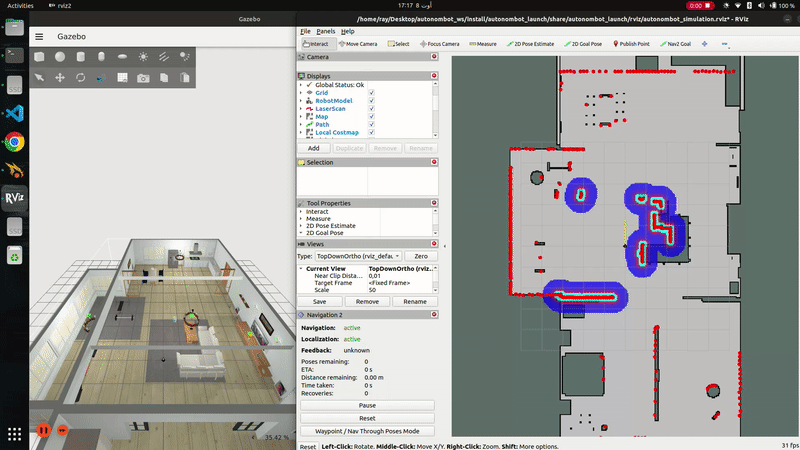

# AutonomBot - 自主导航机器人

[English](README.md)

AutonomBot 是基于 ROS 2 与 Nav2 的室内 AMR 软件栈（上游为大学项目，感谢上游团队设计硬件），本 fork 适配 **CIX P1 边缘平台**：Gazebo 仿真、定位、路径规划与 **NPU 视觉加速**（SDK 包 `cix_ros_noe_yolo`）。变更清单见 [NOTICE](NOTICE)，上游仓库见 [houimliraed/autonomous_ai_rbt](https://github.com/houimliraed/autonomous_ai_rbt)。

机器人使用激光雷达、相机等传感器构建代价地图并做动态避障。视觉默认在板端 NPU 上运行 YOLO，将检测负载从主 CPU 卸载，便于仿真、Nav2 与视觉并行运行。

## 视频演示



> **演示内容：**
> - 仿真环境中的自主导航
> - 实时障碍物检测与避障
> - 动态路径规划与重规划
> - 多传感器融合（激光雷达 + 相机 + 超声波）

*完整视频：[下载 WebM](media/autonombot_demo.webm)*

## 功能特性

- **自主导航**：基于 Nav2 的路径规划与避障
- **多传感器融合**：激光雷达、相机、超声波
- **计算机视觉**：YOLOv8 目标检测（CIX NPU）
- **SLAM 建图**：实时建图与定位
- **硬件支持**：CIX P1（CD8180，aarch64）

## 平台与前置说明

| 项 | 说明 |
|----|------|
| 系统 | 仅 Ubuntu 22.04 + ROS 2 Humble（aarch64）——**不支持 Ubuntu 24.04 / ROS 2 Jazzy** |
| 硬件 | CIX P1 板 + 板端 NPU 运行时（`libnoe` 等，通常在 `/usr/share/cix/lib`） |
| 工作区 | **本仓库本身就是 colcon 工作区**，可放到任意路径（例如 `~/cix-autonombot`，或 SDK 内的 `demos/...`）；`run_sim.sh` 以仓库根目录为准，不依赖固定父目录名 |
| NPU 包 | `cix_ros_noe_yolo` **不在本仓库内 vendored**；通过 SDK deb，或另行编译 SDK 的 `ros_packages/` 后设置 `ROBOTICS_SDK_ROOT` 提供 |

仿真世界 `small_house` / `small_warehouse` 等资源来自 AWS RoboMaker（Apache 2.0），详见 [NOTICE](NOTICE)。

下文用 `$DEMO_WS` 表示**本仓库根目录**（含 `src/`、`scripts/` 的那一层）。请按你的实际克隆路径替换。

## 快速开始

### 1. 获取本仓库

```bash
git clone <本仓库地址> "$DEMO_WS"
cd "$DEMO_WS"
```

（若你是从完整 [CIX Robotics SDK](https://github.com/cix-robotics/robotics_sdk) 里使用，`$DEMO_WS` 也可能指向 SDK 下的某个 demo 子目录，用法相同。）

### 2. 安装 ROS 2 环境（Humble / aarch64）


- 已有完整 SDK 树时，可使用其中的 `scripts/setup_ros2_humble_arm64.sh`
或自行安装 ROS 2 Humble + Nav2 / Gazebo 等依赖

### 3. 编译本仓库

```bash
cd "$DEMO_WS"
source /opt/ros/humble/setup.bash
colcon build --symlink-install
```

### 4. 安装 `cix_ros_noe_yolo`（二选一）

仿真默认启用 NPU YOLO，需要此包出现在 ROS 搜索路径中。

**方式 A：从 SDK 源码编译**（SDK 可在任意路径，不必与 `$DEMO_WS` 同级）

```bash
cd <你的_robotics_sdk>/ros_packages
source /opt/ros/humble/setup.bash
colcon build --base-paths cix_ros_noe_yolo --packages-select cix_ros_noe_yolo --symlink-install
```

之后启动时设置（变量名必须是 **`ROBOTICS_SDK_ROOT`**，不要写成 `ROBOTICS_SDK`）：

```bash
export ROBOTICS_SDK_ROOT=<你的_robotics_sdk>
```

**方式 B：从 deb 安装**

> 目前尚未提供。deb 就绪并装到 `/opt/ros/humble` 后，一般**不必**再设 `ROBOTICS_SDK_ROOT`。

### 5. 下载 NPU 模型权重（`.cix`）

`.cix` 模型不随本仓库 / deb 分发（AGPL-3.0），装好包后下载一次即可：

```bash
source /opt/ros/humble/setup.bash
# 若用源码包，先 source 其 install；若用 deb，通常可省略下一行
source "$ROBOTICS_SDK_ROOT/ros_packages/install/setup.bash"   # 仅方式 A

sudo bash "$(ros2 pkg prefix cix_ros_noe_yolo)/share/cix_ros_noe_yolo/scripts/download_models.sh"
```

模型目录：

`$(ros2 pkg prefix cix_ros_noe_yolo)/share/cix_ros_noe_yolo/model/`

### 6. 检验环境

```bash
cd "$DEMO_WS"
source /opt/ros/humble/setup.bash
source install/setup.bash
# 方式 A 时再：
# export ROBOTICS_SDK_ROOT=<你的_robotics_sdk>
# source "$ROBOTICS_SDK_ROOT/ros_packages/install/setup.bash"

ros2 pkg prefix autonombot_launch
ros2 pkg prefix cix_ros_noe_yolo
```

两条命令都应打印出安装前缀路径，而不是 `Package not found`。

### 7. 启动仿真

```bash
cd "$DEMO_WS"
# 方式 A（源码 SDK）时需要：
export ROBOTICS_SDK_ROOT=<你的_robotics_sdk>

./scripts/run_sim.sh launch
```

`run_sim.sh` 会清理旧进程、拉起 Gazebo + Nav2 + 视觉，并自动打开 `rqt_image_view`（默认订阅 `/vision/yolo_debug_image`）。也可改看 `/vision_debug` 或 `/camera/image_raw`：`./scripts/view_yolo_debug.sh /camera/image_raw`。

若长期使用源码方式的 `cix_ros_noe_yolo`，可把 `export ROBOTICS_SDK_ROOT=...` 写入 `~/.bashrc`。

### 远程终端（SSH / 串口）

Gazebo 要开窗口，因此启动依赖板端可用的 X display。板子本机桌面终端本身就有，远程 shell 一般没有：远程 X11 转发（MobaXterm 串口终端的 `DISPLAY=localhost:10.0`、`ssh -X`）在这里打不开 Gazebo 窗口，仿真启动几秒后就会退出。

在 `run_sim.sh` 之前先导出：

```bash
# 仅 SSH / 远程终端需要；本机桌面 Terminal 一般不需要
export DISPLAY=:0
export XDG_RUNTIME_DIR=/run/user/$(id -u)
export XAUTHORITY=$(ls -t /run/user/$(id -u)/.mutter-Xwaylandauth.* | head -1)

./scripts/run_sim.sh launch
```

### 停止

启动终端按 `Ctrl+C` 即可。若会话异常退出留下残留进程，下次 `run_sim.sh` 启动时会自动清理。

## NPU 视觉说明

`run_sim.sh` 默认把 NPU YOLO 与仿真栈一起拉起，无需再开第二个终端单独启推理节点。

| 组件 | 角色 |
|------|------|
| `cix_ros_noe_yolo`（`npu_yolo_coco_inference`） | 订阅 `/camera/image_raw`，在 NPU 上跑 YOLOv8n `.cix`，发布检测结果 |
| `advanced_vision_navigator` | 在 NPU 激活时消费外部检测，生成障碍点云 / 标记 / `/vision_debug`，供 Nav2 使用 |

主要话题：

| 话题 | 类型 / 含义 |
|------|-------------|
| `/camera/image_raw` | 仿真相机原图 |
| `/vision/detections_2d` | NPU 检测（`vision_msgs/Detection2DArray`） |
| `/npu_vision_active` | NPU 是否声明接管视觉（`std_msgs/Bool`） |
| `/vision/yolo_debug_image` | NPU YOLO 调试图（`rqt_image_view` 默认订阅） |
| `/vision_debug` | 标注调试图 |
| `/vision_obstacles` | 视觉障碍点云（接入 Nav2 局部代价地图） |

更深的集成与移植说明见：[docs/npu_vision_npu_integration.md](docs/npu_vision_npu_integration.md)、[docs/yolo_advanced_vision.md](docs/yolo_advanced_vision.md)。

## 网络与多终端环境

仿真 launch 会隔离 DDS：`ROS_DOMAIN_ID=61`、本机回环、以及 Fast DDS 共享内存 profile（启动后写入 `/tmp/fastdds_shm_only.xml`）。**任何新开的终端**若要 `ros2 topic` / `ros2 node` 看到仿真栈，须与仿真环境一致：

```bash
cd "$DEMO_WS"
source scripts/env.sh
# 方式 A 时再 export ROBOTICS_SDK_ROOT=... 并 source 其 ros_packages/install/setup.bash
```

> `ros2 topic hz` / `ros2 topic list` 依赖后台 `ros2` 守护进程。若守护进程是在其他环境下启动的，请在匹配后的终端里执行一次 `ros2 daemon stop`，它会以当前环境自动重启。

## 启动后检查（可选）

```bash
ros2 node list | grep yolo
ros2 topic list | grep -E 'camera|vision'
ros2 topic hz /camera/image_raw
ros2 topic hz /vision/detections_2d
ros2 topic hz /vision_debug
ros2 topic echo /npu_vision_active --once
```

## 使用说明

- **导航**：在 RViz 中用 “2D Goal Pose” 发送目标即可。
- **手柄**：仿真启动时会自动带上手柄遥控（经 `twist_mux` 与导航速度合流）。
- **图像**：`run_sim.sh` 约 20s 后自动打开 `rqt_image_view` 并选中 `/vision/yolo_debug_image`；也可 `./scripts/view_yolo_debug.sh [topic]`。

## 工作空间目录

- `src/` - ROS 2 功能包源码（长期维护区）
- `build/` - colcon 编译中间产物（可删后重建）
- `install/` - 安装输出；运行前需 `source install/setup.bash`
- `log/` - 编译日志
- `docs/` - 补充文档
- `media/` - 演示 GIF / WebM
- `scripts/` - `run_sim.sh`、`env.sh` 等

典型流程：`src` 改代码 → `colcon build` → `source install/setup.bash` → `./scripts/run_sim.sh launch`。

目录与包职责详解：[docs/仓库目录与功能包说明.md](docs/仓库目录与功能包说明.md)

## 功能包结构

`src/` 下共八个功能包：

| 包名 | 作用 |
|------|------|
| `autonombot_launch` | 顶层 launch 与配置，串起仿真 / 驱动 / 导航 / 视觉 |
| `autonombot_description` | URDF/xacro、网格、Gazebo 世界与模型 |
| `autonombot_firmware` | ros2_control 硬件接口、串口 / 传感器节点 |
| `autonombot_drivers` | Python 驱动与控制器（twist 中继、teleop 集成等） |
| `autonombot_localization` | AMCL、robot_localization、地图服务、超声波融合 |
| `autonombot_mapping` | SLAM（`slam_toolbox`）、`maps/` 地图资源 |
| `autonombot_navigation` | Nav2 规划器、控制器、行为树与参数 |
| `autonombot_vision` | 视觉导航（`advanced_vision_navigator`）、障碍与代价地图 |

NPU YOLO 推理（`cix_ros_noe_yolo`）**不在本仓库内**（见快速开始）。本仓库没有独立的 `autonombot_planning` 包。

## 依赖

- Ubuntu 22.04 + ROS 2 Humble（aarch64）
- Nav2 Navigation Stack
- Gazebo Simulation
- OpenCV 4.x、PCL
- CIX Robotics SDK（`cix_ros_noe_yolo`）与板端 NPU 运行时

## 许可证

Apache 2.0 License。详见 [LICENSE](LICENSE)。

本仓库 fork 自 [houimliraed/autonomous_ai_rbt](https://github.com/houimliraed/autonomous_ai_rbt)，上游基线 commit 及 CIX 修改清单见 [NOTICE](NOTICE)。

仿真世界与部分模型资源来自 AWS RoboMaker Small House / Small Warehouse（Apache 2.0），详见 [NOTICE](NOTICE)。

NPU `.cix` 模型派生自 Ultralytics 权重，许可为 AGPL-3.0，不随本仓库分发；下载即表示接受其许可条款。若随完整 SDK 发布，另见 SDK 根目录的 `NOTICE.md`。

可选 CPU Ultralytics YOLO（`ultralytics` / `torch` / `torchvision`）**不在**默认安装路径中。如需该路径，请自行从 `src/autonombot_vision/requirements-cpu-optional.txt` 执行 `pip install`，并接受 Ultralytics AGPL-3.0；官方支持的默认路径仍是 NPU（`cix_ros_noe_yolo`）。

目前不接受第三方贡献。
