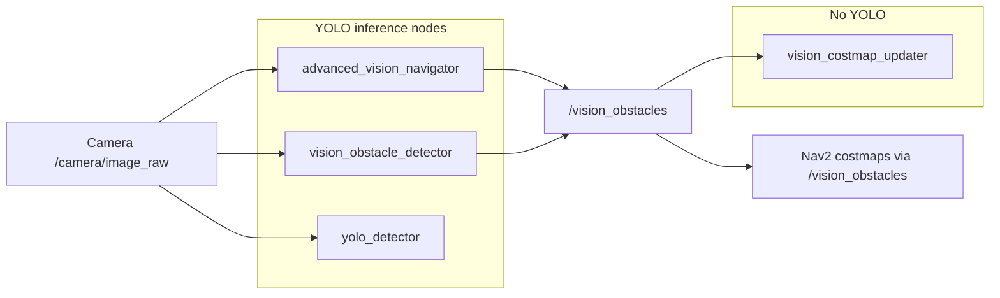

# YOLO-related features and `use_advanced_vision`

This document describes YOLO (Ultralytics YOLOv8) usage in this workspace, what happens when `use_advanced_vision:=true` is passed to `simulated_robot.launch.py`, and how to verify it at runtime.

## YOLO-related packages and nodes

The main package is [`autonombot_vision`](../src/autonombot_vision) (Python, `ament_python`). Optional CPU inference uses Ultralytics YOLOv8; the default weights file is `yolov8n.pt`. The supported default path is NPU via `cix_ros_noe_yolo`.

- Default Python deps: [`requirements.txt`](../src/autonombot_vision/requirements.txt) (`opencv-python`, `numpy` only).
- Optional CPU YOLO (AGPL): [`requirements-cpu-optional.txt`](../src/autonombot_vision/requirements-cpu-optional.txt) (`ultralytics` / `torch` / `torchvision`) — install yourself and accept AGPL-3.0.
- Weights: resolve at runtime from the process working directory or Ultralytics cache; [`.gitignore`](../.gitignore) lists typical weight blobs (with exceptions as documented there).

| Executable | Source | Runs YOLO inference | Role |
|------------|--------|---------------------|------|
| `advanced_vision_navigator` | [`advanced_vision_navigator.py`](../src/autonombot_vision/autonombot_vision/advanced_vision_navigator.py) | Yes (hard dependency on `ultralytics`) | Loads `yolov8n.pt`, obstacle priority / scoring, publishes `PointCloud2` `/vision_obstacles`, `/vision_markers`, `/vision_debug`. |
| `yolo_detector` | [`yolo_detector.py`](../src/autonombot_vision/autonombot_vision/yolo_detector.py) | Yes when installed; else demo mode | General detector: `/detections` (`std_msgs/String`), annotated `/camera/annotated_image`. |
| `vision_obstacle_detector` | [`vision_obstacle_detector.py`](../src/autonombot_vision/autonombot_vision/vision_obstacle_detector.py) | Yes when installed; else demo mode | Nav-oriented pipeline: class filter, rough 3D estimate, publishes `/vision_obstacles`. |
| `minimal_yolo_obstacles` | [`minimal_yolo_obstacles.py`](../src/autonombot_vision/autonombot_vision/minimal_yolo_obstacles.py) | Yes (delegates to `vision_obstacle_detector`) | Compatibility `console_scripts` entry; same behavior as `vision_obstacle_detector`. |
| `vision_costmap_updater` | [`vision_costmap_updater.py`](../src/autonombot_vision/autonombot_vision/vision_costmap_updater.py) | No | Subscribes `/vision_obstacles`, publishes `/vision_costmap` (`nav_msgs/OccupancyGrid`). |

Console entry points are registered in [`setup.py`](../src/autonombot_vision/setup.py).

### Separate launch file

[`vision_navigation.launch.py`](../src/autonombot_vision/launch/vision_navigation.launch.py) starts `vision_obstacle_detector`, `vision_costmap_updater`, and `yolo_detector` together when `use_vision:=true`. It is **not** included by [`simulated_robot.launch.py`](../src/autonombot_launch/launch/simulated_robot.launch.py) by default.

### Top-level robot launches

[`simulated_robot.launch.py`](../src/autonombot_launch/launch/simulated_robot.launch.py) and [`real_robot.launch.py`](../src/autonombot_launch/launch/real_robot.launch.py) expose `use_advanced_vision`. When true, they start **`advanced_vision_navigator` only** (not the full `vision_navigation.launch.py` stack).

### Nav2 integration

[`controller_server.yaml`](../src/autonombot_navigation/config/controller_server.yaml) and [`planner_server.yaml`](../src/autonombot_navigation/config/planner_server.yaml) configure the local costmap `observation_sources` as `scan` plus `vision_obstacles`, with topic **`/vision_obstacles`**. Any node publishing a valid `sensor_msgs/PointCloud2` there can feed Nav2 as a vision obstacle layer. Both `advanced_vision_navigator` and `vision_obstacle_detector` publish to that topic.

### Simulation camera topic

[`gazebo.launch.py`](../src/autonombot_description/launch/gazebo.launch.py) bridges the simulated camera so that **`/camera/image_raw`** (and camera info) are available. `advanced_vision_navigator` subscribes to `/camera/image_raw`.

## Does `use_advanced_vision:=true` start YOLO?

**Yes.** With `use_advanced_vision:=true`, [`simulated_robot.launch.py`](../src/autonombot_launch/launch/simulated_robot.launch.py) adds a node with `IfCondition(use_advanced_vision)`:

- Package: `autonombot_vision`
- Executable: `advanced_vision_navigator`
- Default node name: `advanced_vision_navigator`

That node loads YOLO in `__init__` (see the same source file). It does **not** start `yolo_detector` or `vision_obstacle_detector`. To run those together, launch [`vision_navigation.launch.py`](../src/autonombot_vision/launch/vision_navigation.launch.py) separately (or compose your own launch file).

**Dependencies:** For the CPU path, `advanced_vision_navigator.py` imports `YOLO` from `ultralytics` only when CPU inference is enabled. If `ultralytics` is missing, install `requirements-cpu-optional.txt` (AGPL) or use the NPU path instead. If `yolov8n.pt` cannot be loaded, check the launch terminal output.

## How to verify YOLO path is active (detailed)

### 1. Launch terminal logs

After startup, look for a log line indicating the model loaded successfully (see `advanced_vision_navigator` logger messages in source). Errors such as failed model load or `ImportError` for `ultralytics` mean YOLO is not usable in that process.

### 2. Node presence and interfaces

```bash
ros2 node list | grep advanced_vision
ros2 node info /advanced_vision_navigator
```

Expect subscriptions including `/camera/image_raw` and publishers including `/vision_obstacles`, `/vision_markers`, `/vision_debug`.

### 3. Camera stream

```bash
ros2 topic hz /camera/image_raw
ros2 topic info /camera/image_raw
```

If there is no message rate, the vision node will not run inference on new frames.

### 4. Vision outputs

```bash
ros2 topic hz /vision_obstacles
ros2 topic hz /vision_debug
ros2 topic echo /vision_markers --once
```

Stable rates on `/vision_obstacles` and/or `/vision_debug` usually mean the image callback and detection pipeline are running.

### 5. RViz2

Add an **Image** display and set the topic to **`/vision_debug`** to view annotated debug frames when messages are present.

### 6. Nav2 linkage (optional)

```bash
ros2 topic echo /local_costmap/costmap --once
```

You can also inspect `controller_server` / `local_costmap` logs to confirm the `vision_obstacles` source is active when the costmap is running and point clouds are valid.

### 7. Process list

```bash
pgrep -af advanced_vision_navigator
```

## Data flow (summary)



## Summary

- YOLO inference code lives in **`yolo_detector.py`**, **`vision_obstacle_detector.py`**, and **`advanced_vision_navigator.py`**.
- **`vision_costmap_updater.py`** only consumes **`/vision_obstacles`**; it does not load a model.
- **Nav2 YAML** wires **`/vision_obstacles`** into costmaps; it contains no YOLO implementation.

## Example command

```bash
ros2 launch autonombot_launch simulated_robot.launch.py world_name:=small_house use_advanced_vision:=true
```

This starts YOLO **only** via `advanced_vision_navigator` (not the full `vision_navigation.launch.py` stack). Use the checks above to confirm nodes, topics, and logs.
