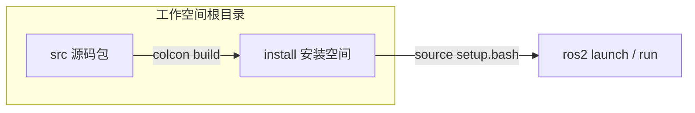

# AutonomBot 仓库目录与各功能包说明

本仓库是 ROS 2 Humble 的 colcon 工作空间，源码集中在 `src/` 下的 8 个 `autonombot_*` 功能包；根目录另有构建产物与 CI 等目录。

## 根目录（工作空间顶层）

| 路径 | 作用 |
|------|------|
| `src/` | **唯一应长期维护的源码区**：所有 ROS 2 功能包放在此处，`colcon build` 默认只编译这里。 |
| `build/` | colcon 编译中间文件（CMake 缓存、对象文件等），可安全删除后重建。 |
| `install/` | 安装前缀：`source install/setup.bash` 后才会找到各包的 launch、可执行文件与资源。 |
| `log/` | 每次构建的日志（如 `build_*/` 子目录）。 |
| `.github/workflows/` | GitHub Actions，例如 ROS 2 构建检查。 |
| `media/` | 演示资源（README 中的 GIF/WebM 等；若本地为空可能是未拉取大文件或未提交）。 |
| `README.md`、`LICENSE` | 项目说明与 Apache 2.0 许可证。 |

典型数据流：**你在 `src` 改代码 → `colcon build` → 产物进 `install` → 终端 `source install/setup.bash` 后运行 launch。**

---

## `src/` 下的 ROS 2 功能包（共 8 个）

以下每个目录名即 **ROS 包名**（与 `package.xml` 中 `<name>` 一致）。

### 1. `autonombot_launch`

- **角色**：**系统入口与集成启动**：把仿真/真机、驱动、描述、定位、建图、导航、视觉等用 launch 文件串起来。
- **依赖关系**：`package.xml` 中 `exec_depend` 列出了 `autonombot_firmware`、`autonombot_drivers`、`autonombot_description`、`autonombot_localization`、`autonombot_mapping`、`autonombot_navigation`、`autonombot_vision` 以及 `rplidar_ros`、`rviz2` 等。
- **常见子目录**：`launch/`（如 `simulated_robot.launch.py`、`real_robot.launch.py`）、`config/`（参数与 RViz 等）、`rviz/`。

### 2. `autonombot_description`

- **角色**：**机器人模型与仿真世界**：URDF/xacro、网格（`meshes/`）、Gazebo 世界（`worlds/`）、可选 RViz 配置；并依赖 `ros_gz_sim`、`ros_gz_bridge` 等与 Gazebo 对接。
- **子目录要点**：`urdf/` 机器人链路；`models/` 内含大量 AWS RoboMaker 风格环境模型，用于丰富仿真场景。

### 3. `autonombot_firmware`

- **角色**：**贴近硬件的一层**：面向 Jetson 等部署；包含 **ros2_control 硬件接口插件**（`CMakeLists.txt` 中 `autonombot_interface` 库 + `autonombot_interface.xml`），以及串口/传感器相关 Python 节点（如 `simple_serial_transmitter.py`、`hcsr04_driver.py`、`jetson_sensor_manager.py`）。
- **其他**：`firmware/` 下还有 Arduino 等嵌入式工程（如 `robot_control`、`simple_encoder_reader`）；`launch/`、`scripts/` 用于真机启动与校验。

### 4. `autonombot_drivers`

- **角色**：**驱动与中间控制逻辑**（偏 Python）：与 `ros2_control`、`twist_mux`、手柄 `joy` 等配合；包内模块例如 `twist_relay.py`、`noisy_controller.py`（用于仿真或测试中的速度/噪声注入）。
- **子目录**：`launch/`、`config/`、`autonombot_drivers/`（Python 包）。
- **键盘遥控（ROS 2 Humble）**：仿真/真机 launch 会起 `twist_mux`，其中配置了 `key_vel` 输入。另开一个**可交互终端**，在已 `source install/setup.bash` 后执行：  
  `ros2 run teleop_twist_keyboard teleop_twist_keyboard --ros-args -r cmd_vel:=key_vel`  
  需已安装 `ros-humble-teleop-twist-keyboard`。不要用默认的 `/cmd_vel` 话题，否则走的是 mux 里导航那一路，与键盘通道设计不一致。

### 5. `autonombot_localization`

- **角色**：**定位**：集成 `robot_localization`、`nav2_amcl`、`nav2_map_server`、生命周期管理等；描述中强调与**超声波**等传感器融合相关的定位场景。
- **子目录**：`launch/`、`config/`、`rviz/`；另有 `autonombot_localization/` Python 包目录（自定义节点或工具）。

### 6. `autonombot_mapping`

- **角色**：**建图（SLAM）**：依赖 `slam_toolbox`，配合 `nav2_map_server` 等；维护或引用预制地图。
- **子目录**：`maps/`（如 `small_house`、`small_warehouse`）、`launch/`、`config/`、`rviz/`、`autonombot_mapping/`。

### 7. `autonombot_navigation`

- **角色**：**Nav2 导航栈配置**：规划器、控制器、行为树、平滑器等（`nav2_planner`、`nav2_bt_navigator`、`nav2_regulated_pure_pursuit_controller`、`nav2_smac_planner` 等在 `package.xml` 中列出）。
- **子目录**：`launch/`、`config/`、`behavior_tree/`。

### 8. `autonombot_vision`

- **角色**：**视觉与 YOLOv8**（`ament_python` 包）：图像订阅、`cv_bridge`、与导航结合的代价地图或障碍物信息。
- **可执行入口**（`setup.py` 中 `console_scripts`）：`yolo_detector`、`vision_obstacle_detector`、`vision_costmap_updater`、`advanced_vision_navigator`、`performance_monitor`，以及 `minimal_yolo_obstacles`（[`minimal_yolo_obstacles.py`](../src/autonombot_vision/autonombot_vision/minimal_yolo_obstacles.py) 为兼容入口，内部转调 `vision_obstacle_detector`）。
- **子目录**：`autonombot_vision/*.py`、`launch/`。

---

## README 历史说明

英文 `README.md` 的 “Package Structure” 曾列出 **`autonombot_planning`（高层任务规划）**，但当前仓库中 **没有** 名为 `autonombot_planning` 的包目录或 `package.xml`。若需要该能力，需新增包或单独维护规划栈。

---

## 小结：从目录到功能

- **想一键跑仿真/真机** → `autonombot_launch`
- **改机器人外形、传感器位姿、Gazebo 世界** → `autonombot_description`
- **串口电机、超声波、Jetson GPIO、硬件接口** → `autonombot_firmware`
- **速度多路复用、控制与驱动侧 Python 节点** → `autonombot_drivers`
- **AMCL / EKF / 地图服务器（定位栈）** → `autonombot_localization`
- **SLAM 与地图文件** → `autonombot_mapping`
- **Nav2 参数与行为树** → `autonombot_navigation`
- **YOLO 与视觉代价地图/障碍物** → `autonombot_vision`
